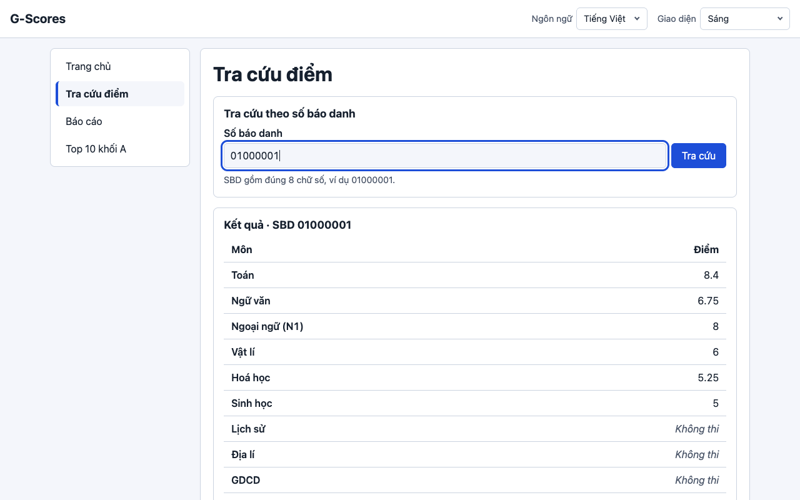
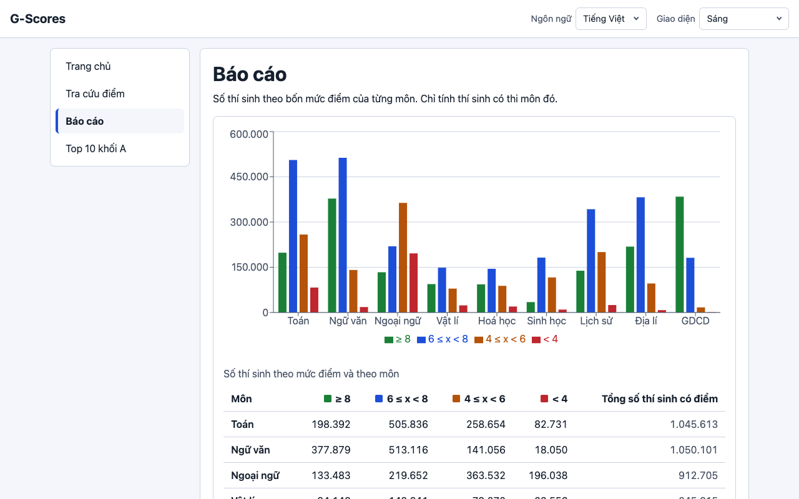
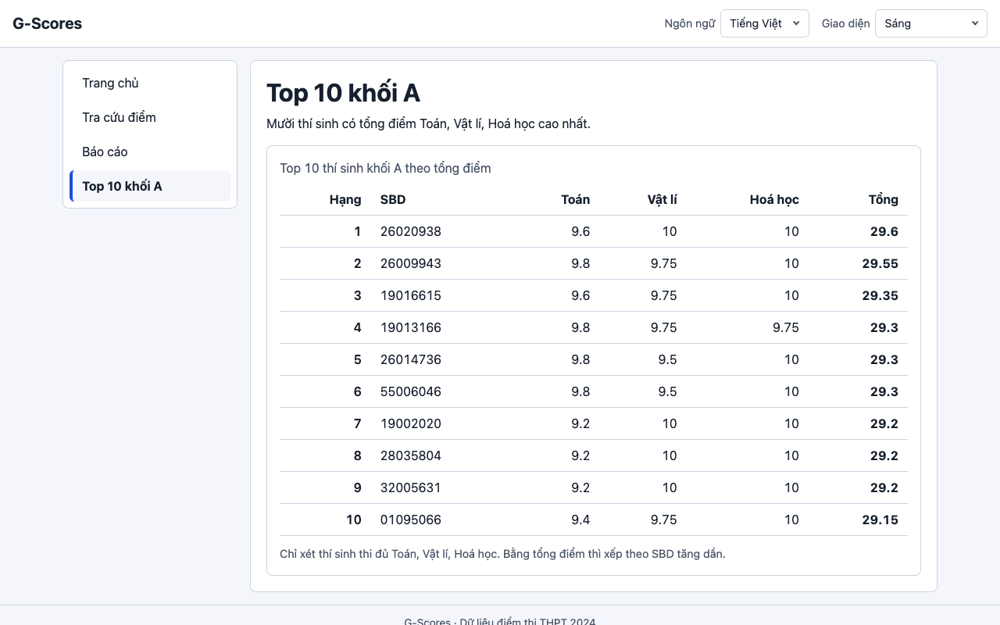
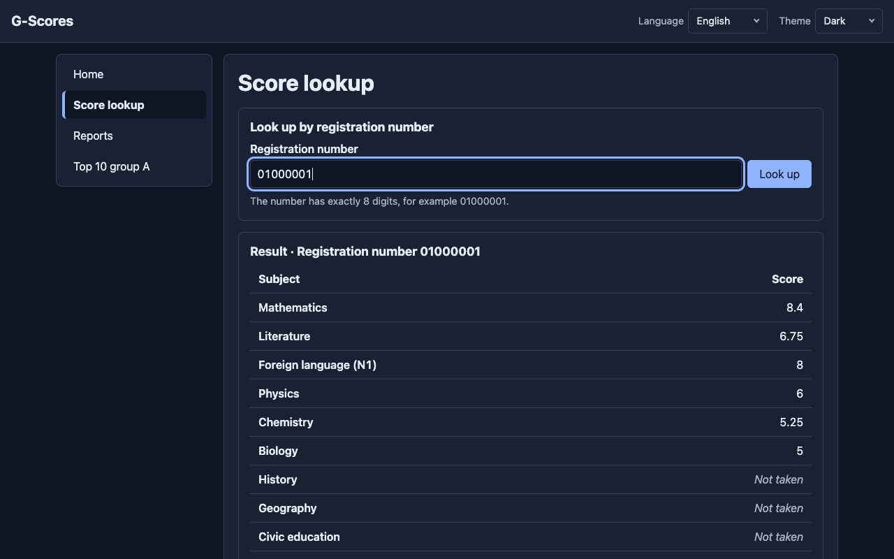

# G-Scores

## Bài nộp: G-Scores (Submission: how to run locally, demo)

G-Scores là ứng dụng web tra cứu và thống kê điểm thi THPT 2024 từ `dataset/diem_thi_thpt_2024.csv` (1.061.605 thí sinh): tra điểm theo số báo danh, biểu đồ số thí sinh theo bốn mức điểm của từng môn, và top 10 thí sinh khối A.

**Demo:** chưa có link demo công khai. Xem [Chạy bằng Docker](#chạy-bằng-docker) (chỉ cần Docker) hoặc [Chạy trên máy](#chạy-trên-máy) (khoảng 5 phút) và [ảnh chụp màn hình](#ảnh-chụp-màn-hình) bên dưới.

### Ảnh chụp màn hình

| Tra cứu `01000001` | Báo cáo theo bốn mức điểm |
|---|---|
|  |  |

| Top 10 khối A | Tra cứu, tiếng Anh, giao diện tối |
|---|---|
|  |  |

### Đối chiếu với đề bài

| Yêu cầu của đề | Trạng thái | Nằm ở đâu |
|---|---|---|
| Đưa dữ liệu thô vào CSDL bằng migration và seeder trong mã nguồn | ✅ | `database/prisma/migrations/`, `database/seed/` |
| Tra điểm theo số báo danh | ✅ | trang `/lookup` · `GET /api/candidates/:sbd` |
| Báo cáo 4 mức điểm theo từng môn (biểu đồ) | ✅ | trang `/reports` · `GET /api/reports/score-levels` |
| Top 10 thí sinh khối A (toán, vật lí, hoá học) | ✅ | trang `/top-group-a` · `GET /api/reports/top-group-a` |
| Responsive | ✅ dùng được ở 360, 768 và 1280 px, không cuộn ngang trang; biểu đồ đổi sang cột ngang khi khung hẹp. Bảng số cuộn ngang **trong khung** ở 360 px | `frontend/` |
| Docker | ✅ một lệnh dựng PostgreSQL, migrate, seed, API và web (`./docker-up.sh`). | `infrastructure/`, `docker-up.sh`, `docker-down.sh` |
| Thêm: tiếng Việt/Anh, giao diện sáng/tối/theo hệ thống | ✅ Tự bổ sung | hai ô chọn ở đầu trang |

**Yêu cầu kỹ thuật:**

- **OOP cho môn học (bắt buộc):** `backend/domain/` gồm `Subject`, `SubjectRegistry`, `SubjectGroup`, `ScoreLevel`, `Score`. Các lớp này quyết định môn nào có, khối A gồm môn nào, điểm thuộc mức nào; tầng service và model chỉ dùng chúng, không viết lại ngưỡng điểm.
- **Validate và chặt logic:** backend validate đầu vào bằng Zod (`backend/schema/`, `backend/middleware/validate.ts`); form tra cứu validate bằng JustValidate ở frontend. Cơ sở dữ liệu có thêm ràng buộc CHECK (định dạng SBD, khoảng điểm) trong migration.
- **ORM:** Prisma 7 cho schema, migration và truy vấn. Chỉ các truy vấn tổng hợp (đếm 4 mức, top 10) dùng SQL thô qua `prisma.$queryRaw` ở `backend/model/report-model.ts` để gộp ngay trong CSDL bằng một lượt quét bảng thay vì kéo 1 triệu dòng về Node. Tên cột lấy từ `SubjectRegistry`, ngưỡng và `limit` là tham số bind; không có gì từ request trở thành tên cột.
- **Frontend:** React Hooks, TypeScript toàn bộ (backend và frontend).

### Công nghệ

| Tầng | Dùng |
|---|---|
| Backend | Express 5, TypeScript, Zod; phân tầng `router → controller → service → model` |
| Cơ sở dữ liệu | PostgreSQL 17 (Docker), Prisma 7 (schema, migration), seeder đọc CSV theo luồng và insert theo lô |
| Frontend | Next.js 16 (App Router), React 19, TypeScript, next-intl (vi/en), next-themes, Recharts |
| Kiểm thử | Vitest (backend và frontend), script đối chiếu độc lập bằng Python 3 |

### Chạy bằng Docker

Cách nhanh nhất: chỉ cần **Docker với Compose v2**, không cần Node, npm hay Python. Cổng trống: 3000 (web), 4000 (API), 5433 (PostgreSQL).

```bash
git clone <repo-url> && cd <repo>
./docker-up.sh        # build image, dựng PostgreSQL, migrate, seed, API, web
./docker-down.sh      # dừng và gỡ container, GIỮ dữ liệu
```

Mở http://localhost:3000. Lần đầu mất vài phút để tải và build image, rồi khoảng 35 giây để nạp 1.061.605 dòng; các lần sau seeder thấy đủ dữ liệu nên bỏ qua (khoảng 15 giây khi không đổi mã).

Hai script chỉ là lối tắt (cần bash). Lệnh gốc, dùng được cả trên Windows:

```bash
docker compose -f infrastructure/docker-compose.yaml --profile app up -d --build
docker compose -f infrastructure/docker-compose.yaml --profile app down
```

- **Chỉ bật PostgreSQL** (cho luồng dev ở mục dưới): lệnh `docker compose -f infrastructure/docker-compose.yaml up -d --wait`, không có `--profile app`.
- `docker-down.sh` dừng **cả** PostgreSQL, nên `npm run dev` đang chạy sẽ mất kết nối CSDL. Dữ liệu vẫn còn trong volume; bật lại bằng một trong hai lệnh `up` ở trên.
- **Xoá cả dữ liệu:** `docker compose -f infrastructure/docker-compose.yaml --profile app down -v` (không có script, vì là việc huỷ dữ liệu). Volume dùng chung với luồng dev.
- **Nạp lại từ đầu** (xoá bảng rồi nạp lại): `docker compose -f infrastructure/docker-compose.yaml run --rm seed npm run db:seed -w backend -- --fresh`.
- **Đổi cổng:** đặt biến môi trường, ví dụ `WEB_PORT=3001 API_PORT=4001 POSTGRES_PORT=5434 ./docker-up.sh`.
- **Đổi mã nguồn:** chạy lại `./docker-up.sh` (có `--build`). Địa chỉ backend được ghi cứng vào image web lúc build.
- **Kích thước image** (đo 17/11/2026 trên chip ARM): `g-scores-api` khoảng 395 MB, `g-scores-web` khoảng 330 MB (trước đây khoảng 2,1 và 2,2 GB), `g-scores-tools` khoảng 860 MB (chỉ chạy một lần để migrate và seed). Số này là dung lượng các lớp; `docker image ls` trên Docker Desktop báo cao hơn (516 MB, 423 MB, 1,18 GB).
- **Không lên được:** xem `docker compose -f infrastructure/docker-compose.yaml --profile app logs seed` (nạp dữ liệu) hoặc `logs api`. Nếu seed lỗi thì API không khởi động. Báo lỗi "port is already allocated" là cổng đang bị chiếm (ví dụ `npm run dev` đang chạy): tắt nó hoặc đổi cổng.
- Cấu hình này không có mật khẩu CSDL và chỉ mở cổng trên `127.0.0.1`: dùng cho máy local, không dùng trên host công khai.

### Chạy trên máy

**Cần có:** Node.js `^22.18 || ^24.11 || >=26` (đã chạy trên 26.6.0), npm, Docker với Compose v2, khoảng 1 GB đĩa trống cho CSDL. Python 3 chỉ cần cho bước đối chiếu tuỳ chọn. Cổng trống: 5433 (PostgreSQL), 4000 (API), 3000 (web).

```bash
git clone <repo-url> && cd <repo>
npm install
cp .env.example .env            # giá trị cho PostgreSQL local, không chứa secret
docker compose -f infrastructure/docker-compose.yaml up -d --wait
npm run db:generate -w backend  # sinh Prisma Client (Prisma 7 không tự sinh khi cài)
npm run db:migrate  -w backend  # áp migration lên CSDL rỗng
npm run db:seed     -w backend  # nạp 1.061.605 dòng, khoảng 35 giây
npm run dev                     # API :4000 + web :3000, Ctrl+C dừng cả hai
```

Mở http://localhost:3000. Không cần tạo `frontend/.env.local`: frontend mặc định chuyển `/api/*` tới `http://127.0.0.1:4000`.

**Kiểm nhanh sau khi lên:**

- `curl http://localhost:4000/api/health` trả `{"data":{"status":"ok"}}`.
- Tra `01000001`: Toán 8,4, Ngữ văn 6,75, Ngoại ngữ 8,0, Vật lí 6,0, Hoá học 5,25, Sinh học 5,0; ba môn còn lại hiện "Không thi".
- Báo cáo: tổng bốn mức của Toán là 1.045.613.
- Top 10 khối A: hạng 1 là `26020938` (29,6 điểm).

**Dừng:** `docker compose -f infrastructure/docker-compose.yaml down` (giữ dữ liệu); thêm `-v` để xoá cả dữ liệu. Lệnh này chỉ dừng PostgreSQL. Nếu bạn đã bật cả ứng dụng bằng `./docker-up.sh` ở mục "Chạy bằng Docker", hãy dừng bằng `./docker-down.sh` (hoặc thêm `--profile app` vào lệnh trên) để các container `api`, `web`, `seed` không bị bỏ sót.

**Chạy bản build (tuỳ chọn):**

```bash
npm run build -w frontend
npm run start -w backend     # một terminal
npm run start -w frontend    # terminal khác
```

Địa chỉ backend (`BACKEND_URL`) được ghi cứng lúc `next build`; nếu đổi, phải build lại frontend. Mẫu ở `frontend/.env.example`.

**Không có Docker:** dùng PostgreSQL 17 cài sẵn, tạo CSDL rồi sửa `DATABASE_URL` trong `.env`. Cách này **chưa được kiểm thử**.

### Kiểm thử và kiểm tra

Chạy từ thư mục gốc:

```bash
npm run test:unit -w backend      # test lớp miền, KHÔNG cần PostgreSQL
npm test -w backend               # thêm test API và schema, cần PostgreSQL đang chạy
npm run lint -w frontend
npm run typecheck -w frontend
npm test -w frontend              # gồm kiểm khoá i18n
npm run build -w frontend
```

`npm test -w backend` chạy trên CSDL riêng `g_scores_test` (Docker tự tạo) và **xoá toàn bộ schema `public` của CSDL đó** mỗi lần chạy; test từ chối chạy nếu tên CSDL không kết thúc bằng `_test`. Backend chưa có lint.

**Đối chiếu số liệu độc lập (tuỳ chọn, cần Python 3, không cần `pip install`):** script đọc thẳng CSV, tự tính lại số liệu rồi so với API. Cần backend đang chạy trên CSDL đã nạp (`npm run start -w backend`).

```bash
python3 -I database/verify/cross_check.py --csv dataset/diem_thi_thpt_2024.csv --api http://127.0.0.1:4000
```

Mã thoát 0 là khớp. Kết quả chạy 17/11/2026 trên bản clone mới từ GitHub: **9/9 môn × 4 mức khớp CSV, top 10 (10/10) và top 20 (20/20) khớp, 164/164 SBD mẫu khớp**; thời gian chạy khoảng 9 giây.

### Quy tắc dữ liệu đã chọn

- **Ô trống là không thi, không phải 0.** Lưu `NULL`, không đưa vào thống kê môn đó (nên tổng thí sinh mỗi môn khác nhau; ví dụ Toán 1.045.613).
- **SBD là chuỗi 8 chữ số**, giữ số `0` ở đầu (`01000001`); không ép sang số. API trả 400 nếu SBD không đúng 8 chữ số, 404 nếu không có trong dữ liệu.
- **Bốn mức điểm:** `≥ 8`, `6 ≤ x < 8`, `4 ≤ x < 6`, `< 4`. Điểm đúng bằng ngưỡng rơi vào mức cao hơn (8,0 thuộc `≥ 8`).
- **Ngoại ngữ** gộp mọi mã ngoại ngữ thành một môn.
- **Top 10 khối A:** chỉ tính thí sinh có đủ cả Toán, Vật lí, Hoá học. Xếp theo tổng giảm dần; **hoà điểm xếp theo SBD tăng dần**, rồi cắt đúng 10 dòng. Tổng cộng bằng số thập phân chính xác, không dùng số thực.

### Cấu trúc thư mục

| Thư mục | Nội dung |
|---|---|
| `backend/` | API Express + TypeScript: `domain/` (OOP môn học), `router/`, `controller/`, `service/`, `model/`, `schema/`, `middleware/`, `test/` |
| `frontend/` | Next.js: `app/` (trang), `components/`, `messages/` (vi/en), `lib/` |
| `database/` | `prisma/` (schema, migration), `seed/` (seeder), `verify/` (đối chiếu độc lập) |
| `dataset/` | CSV điểm thi của đề (chỉ đọc) |
| `infrastructure/` | `docker-compose.yaml` (PostgreSQL; profile `app` thêm seed, API, web); Dockerfile nằm cạnh mã: `backend/Dockerfile` (target `tools`, `api`), `frontend/Dockerfile` (target `web`) |
| gốc repo | `docker-up.sh`, `docker-down.sh`: bật/tắt cả ứng dụng bằng Docker |
| `scripts/` | `dev.mjs`: chạy API và web cùng lúc |

- **Đổi `BACKEND_URL`:** phải `npm run build -w frontend` lại.
- **Trang báo cáo báo "chưa có dữ liệu":** chưa chạy `db:seed`.

---

*Đề bài gốc ↓ (giữ nguyên)*

---

This is the instruction for web developer intern assignment at [Golden Owl](https://goldenowl.asia). You will build a simple web.

Web template example. Hope you will make it more beautiful !!!

 
# Requirements
1. From the raw data file ([diem_thi_thpt_2024.csv](./dataset/diem_thi_thpt_2024.csv)) save it into the database with the appropriate structure

2. Your application should have at least features in [Must have](#must-have), things in [Nice to have](#nice-to-have) is optional (but yeah, it's attractive if you have).

### Must have:
- The conversion of raw data into the database must be coded and located in this source code. (**hint**: recommend use migration and seeder)
- Write a feature to check score from registration number input
- Write a feature report. There will be 4 levels including: >=8 points, 8 points > && >=6 points, 6 points > && >= 4 points, < 4 points
    - Statistics of the number of students with scores in the above 4 levels by subjects. (Chart)
- List top 10 students of group A including (math, physics, chemistry)
### Nice to have:

- Responsive design (look good on all devices: desktops, tablets & mobile phones).
- Setup project use Docker.
- Deploy the application to go live.

# Technical Requirements

### Frontend
You can use any front-end library/framework like React, Angular, Vue, ... or just simple things with HTML + CSS + Javascript (JQuery).
- For JS intern use React you need to have: 
  * React Hooks
- Fonts (optional);
  - [https://fonts.google.com/specimen/Rubik?query=Rubik](https://fonts.google.com/specimen/Rubik?query=Rubik)
- You can use some available interfaces such as: [AdminLTe](https://adminlte.io/), [TailAdmin](https://tailadmin.com/)...
  
### Backend: 
Choose one of your applied back-end libraries/frameworks: Maybe Laravel(PHP), Ruby on Rails, NestJS (NodeJs), Django (Python), unlimited framework... or a structure that you come up with yourselt. 
- **Mandatory** use of **OOP programming** for managing subjects.
- Need form validation and logic tightening.
- For NodeJs, use TypeScript is a plus.
- Use ORM for interacting with Database.
- Database: You can use postgreSQL, Mysql, mongoDB... to manage or cache the data. 

### Deployment
Some providers allow free deployment for the trial version  (note: Maybe some suppliers will update their policies and prices)

- Heroku - https://heroku.com - Deploying Front & Backend
- Vercel (Zeit) - https://vercel.com - Deploying Front & Backend apps at free of cost
- Fly - https://fly.io - Deploying Front & Backend apps at free of cost
- Deta - https://deta.sh - Deploying Node.js and Python apps and APIs. They support most web frameworks like Express, Koa, Flask, and FastAPI. They also provide a very fast and powerful NoSQL database for free.
- Heliohost - https://heliohost.org - PHP, Ruby on rails, perl, django, java(jsp)
- `...`
# Submission

After completing the assignment, please push the source code to remote repository (github/gitlab), then send us the link to your repository.

Don't forget to add `README.md` which includes guide to run your project locally and demo link.


**GOOD LUCK!!!**


# Contributors

- Edric Cao (from GO)
